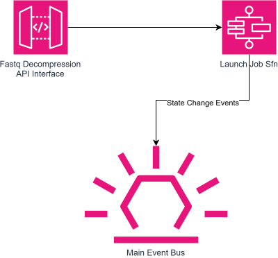
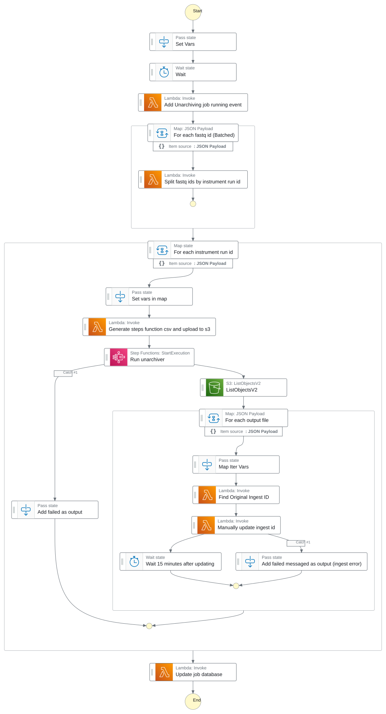

# Fastq Unarchiving Service

- [Overview](#overview)
- [Service Flow](#service-flow)
  - [1. Create an unarchiving job (API)](#1-create-an-unarchiving-job-api)
  - [2. S3 Steps Copy (archive → cache)](#2-s3-steps-copy-archive--cache)
  - [3. Update ingest ids](#3-update-ingest-ids)
  - [4. Job state change event](#4-job-state-change-event)
- [Event Contract](#event-contract)
  - [Consumed Events](#consumed-events)
  - [Published Events](#published-events)
- [Using the Service](#using-the-service)
  - [Part 1: Getting the Fastq IDs to unarchive](#part-1-getting-the-fastq-ids-to-unarchive)
  - [Part 2: Unarchiving the Fastq Files](#part-2-unarchiving-the-fastq-files)
- [Infrastructure](#infrastructure)
  - [Stateful Resources](#stateful-resources)
  - [Stateless Resources](#stateless-resources)
  - [Stacks](#stacks)
- [CI/CD and Release Management](#cicd-and-release-management)
- [Related Services](#related-services)
- [Glossary & References](#glossary--references)

---

## Overview

This service restores archived FASTQ files from deep-archive storage back to the original
cache bucket, so they become accessible again through the [Fastq Manager](https://github.com/OrcaBus/service-fastq-manager).

Unarchiving jobs are triggered via a RESTful API (not by consuming events). The Swagger
documentation of the production endpoint is available at
[https://fastq-unarchiving.prod.umccr.org/schema/swagger-ui#/](https://fastq-unarchiving.prod.umccr.org/schema/swagger-ui#/).

An unarchiving job can take ~10 hours to complete.



---

## Service Flow

The service orchestrates a single Step Function state machine that drives an unarchiving job
from creation through to completion.



### 1. Create an unarchiving job (API)

A caller `POST`s a list of fastq ids and a job type (e.g. `S3_UNARCHIVING`) to the API. A job
record is persisted and the state machine is started.

### 2. S3 Steps Copy (archive → cache)

**State machine**: [`run_s3_steps_copy_sfn_template`](app/step-functions-templates/run_s3_steps_copy_sfn_template.asl.json)

The state machine calls the external [s3-steps-copy](https://github.com/umccr/steps-s3-copy)
service to copy the FASTQ files from the archive bucket back to the original cache bucket, then
checks that each copy step completed successfully.

### 3. Update ingest ids

After the copy, the service updates the ingest id of the restored FASTQ files to match those of
the original archived files. This makes the Fastq Manager resolve S3 URIs to the restored cache
copies instead of the archived ones.

### 4. Job state change event

As the job progresses, the service publishes a `FastqUnarchivingJobStateChange` event announcing
job state changes.

---

## Event Contract

### Consumed Events

There are no consumed events for this service. Jobs are triggered via the REST API endpoints.

### Published Events

| DetailType                       | Source                     | Schema                                                                                      | Description                 |
|----------------------------------|----------------------------|---------------------------------------------------------------------------------------------|-----------------------------|
| `FastqUnarchivingJobStateChange` | `orcabus.fastqunarchiving` | [fastq-unarchiving-job-state-change](event-schemas/fastq-unarchiving-job-state-change.json) | Announces job state changes |

---

## Using the Service

To use the fastq unarchiving service, you will need to know the fastq ids of the fastq files you
want to unarchive. Given a library id, you can find the fastq ids by querying the Fastq Manager
service.

### Part 1: Getting the Fastq IDs to unarchive

```shell
# Globals
AWS_PROFILE='umccr-production'
FASTQ_SET_API_ENDPOINT="https://fastq.prod.umccr.org/api/v1/fastqSet"
FASTQ_UNARCHIVING_ENDPOINT="https://fastq-unarchiving.prod.umccr.org/api/v1/jobs"

ORCABUS_TOKEN="$( \
  aws secretsmanager get-secret-value \
    --secret-id orcabus/token-service-jwt \
    --output json \
    --query SecretString | \
  jq --raw-output \
    'fromjson | .id_token' \
)"

# Glocals
LIBRARY_ID_LIST=( \
  "L2301201" \
  "L2301202" \
)

# Get the query parameters
QUERY_PARAMS="$( \
  jq --raw-output --null-input \
    --arg libraryIdListStr "${LIBRARY_ID_LIST[*]}" \
    '
      $libraryIdListStr | split(" ") |
      map(
        "library[]=\(.)"
      ) |
      . += [
        # We want to know which fastq sets have fastq files in DeepArchive
        # So we need to include the s3 details to get the storage class
        "includeS3Details=true",
        # And we only want the current fastq sets for each library
        "currentFastqSet=true"
      ] |
      join("&")
    ' \
)"

fastq_id_list="$( \
  curl --request GET \
    --fail --silent --show-error --location \
    --header "Accept: application/json" \
    --header "Authorization: ${ORCABUS_TOKEN}" \
    --url "${FASTQ_SET_API_ENDPOINT}?${QUERY_PARAMS}" | \
  jq --raw-output \
    '
      .results |
      # Iterate over the fastq sets
      map(
        # Filter for fastq sets with readSet.r1.storageClass == "DeepArchive"
        .fastqSet |
        map(
          select(
            .readSet.r1.storageClass == "DeepArchive"
          )
        ) |
        # And get the fastq ids in the fastq set
        map(
          .id
        )
      ) |
      # Flatten the list of fastq ids (since weve mapped within a map)
      flatten
    ' \
)"
```

### Part 2: Unarchiving the Fastq Files

Now we have our list, we can generate the JSON body for the unarchiving post request,
and send it to the fastq unarchiving service to trigger the unarchiving job.

This will take around 10 hours to complete.

```shell

fastq_unarchiving_job_json_body="$( \
  jq --null-input \
    --argjson fastqIdList "${fastq_id_list}" \
    '
      {
          "fastqIdList": $fastqIdList,
          "jobType": "S3_UNARCHIVING"
      }
    ' \
)"

curl --request POST \
  --fail --silent --show-error --location \
  --header "Accept: application/json" \
  --header "Content-Type: application/json" \
  --header "Authorization: ${ORCABUS_TOKEN}" \
  --data "${fastq_unarchiving_job_json_body}" \
  --url "${FASTQ_UNARCHIVING_ENDPOINT}" | \
jq --raw-output
```

---

## Infrastructure

The service is deployed via AWS CDK. Resources are split into two stacks: stateful (data/config)
and stateless (compute/events).

Event source: `orcabus.fastqunarchiving`

### Stateful Resources

- **DynamoDB** — persists unarchiving job records and their state.

### Stateless Resources

- **API handler** (Python) — the REST API in [`app/interface/`](app/interface/), exposing the
  versioned `api/v1` routes for creating and querying jobs.
- **Lambda functions** (Python) — one per task in the state machine; see [`app/lambdas/`](app/lambdas/)
  (e.g. `generate_jsonl_py`, `check_successful_steps_copy_py`, `find_original_ingest_id_py`,
  `update_ingest_id_py`, `update_job_database_py`, `sync_filemanager_py`).
- **Step Functions state machine** — the ASL template in
  [`app/step-functions-templates/`](app/step-functions-templates/).

### Stacks

This CDK project manages multiple stacks. The root stack (the only one that does not include
`DeploymentPipeline` in its stack ID) is deployed in the toolchain account and sets up a
CodePipeline for cross-environment deployments to `beta`, `gamma`, and `prod`.

```sh
# List stateful stacks
pnpm cdk-stateful ls

# List stateless stacks
pnpm cdk-stateless ls

# OrcaBusStatelessServiceStack
# OrcaBusStatelessServiceStack/DeploymentPipeline/OrcaBusBeta/DeployStack (OrcaBusBeta-DeployStack)
# OrcaBusStatelessServiceStack/DeploymentPipeline/OrcaBusGamma/DeployStack (OrcaBusGamma-DeployStack)
# OrcaBusStatelessServiceStack/DeploymentPipeline/OrcaBusProd/DeployStack (OrcaBusProd-DeployStack)
```

---

## CI/CD and Release Management

All changes merged to `main` are automatically built and released across `beta`, `gamma`, and
`prod` environments. Versioning follows Semantic Versioning (semver) via manual git tags.

GitHub Actions enforce quality on every pull request
([`.github/workflows/pr-tests.yml`](.github/workflows/pr-tests.yml)): `make check` for linting
and code formatting, and `pnpm test` for the CDK/IaC tests. A daily `pnpm audit` workflow
([`.github/workflows/pnpm-audit.yml`](.github/workflows/pnpm-audit.yml)) scans dependencies for
vulnerabilities and opens an auto-fix PR when it can resolve them.

---

## Related Services

| Role            | Service                                                                    |
|-----------------|----------------------------------------------------------------------------|
| Fastq           | [Fastq Manager](https://github.com/OrcaBus/service-fastq-manager)          |
| S3 copy         | [s3-steps-copy](https://github.com/umccr/steps-s3-copy)                    |

---

## Glossary & References

For general terms and expressions used across OrcaBus services, please see the platform
[documentation](https://github.com/OrcaBus/wiki/blob/main/orcabus-platform/README.md#glossary--references).

For development setup, build commands, project structure, and conventions see the
[steering docs](.kiro/steering/).

Service specific terms:

| Term      | Description                                                                                                      |
|-----------|------------------------------------------------------------------------------------------------------------------|
| Job       | A unit of unarchiving work, created against a list of fastq ids with a job type (e.g. `S3_UNARCHIVING`).         |
| Fastq id  | Identifies a FASTQ file in the Fastq Manager. Resolve fastq ids from a library id via the fastq set API first.   |
